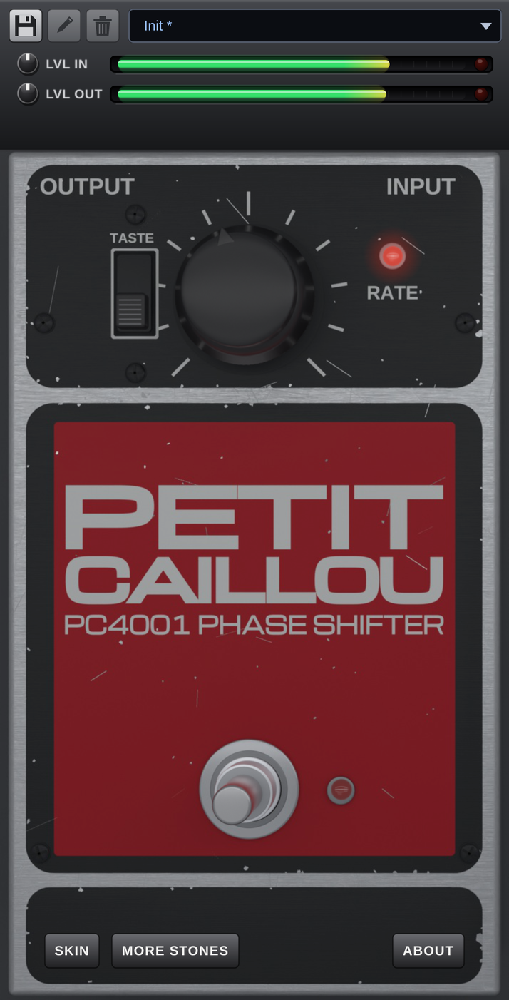
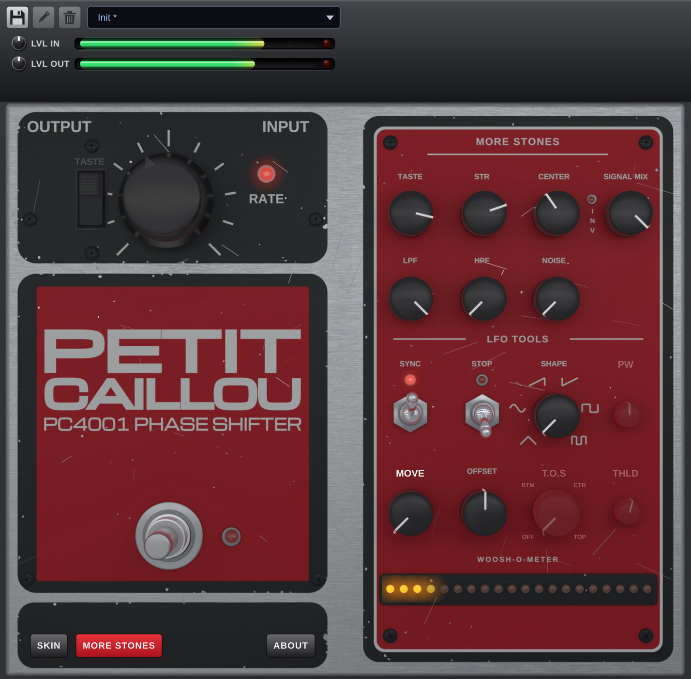
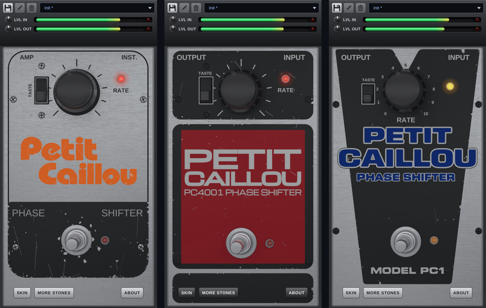

# PetitCaillou

**A free four-stage phaser plugin in the spirit of 1970s phase pedals: warm, simple to play, and deep when you want it to be.**

PetitCaillou gives you the classic one-knob phaser sound out of the box, then lets you open up a second panel (**MORE STONES**) with a full set of tone, feedback and LFO controls. It comes with a realistic 3D interface (built with Blender) in three skins.

| | |
|---|---|
| **Windows 10/11 (64-bit)** | VST3 + standalone application |
| **macOS 10.13 or later** (Apple Silicon and Intel) | AU, VST3 + standalone application |
| **Price** | Free, including in commercial music productions |

<p align="center">
  
  &nbsp;&nbsp;
  
</p>
<p align="center"><sub><b>Normal mode</b> (left) and <b>MORE STONES mode</b> (right), shown in the Warm Red skin.</sub></p>

---

## Table of contents

- [Features](#features)
- [Download and installation](#download-and-installation)
- [Quick start](#quick-start)
- [How it works](#how-it-works)
- [Normal mode](#normal-mode)
- [MORE STONES mode](#more-stones-mode)
- [LVL IN / LVL OUT and indicators](#lvl-in--lvl-out-and-indicators)
- [Presets](#presets)
- [Skins](#skins)
- [Standalone application](#standalone-application)
- [Automation](#automation)
- [Found a problem, have an idea?](#found-a-problem-have-an-idea)
- [License](#license)

---

## Features

- **Four-stage phaser** with a vintage sound, in float and double precision.
- **Two ways to play it**: a simple mode (one RATE knob and a HIGH / LOW TASTE switch) and an advanced **MORE STONES** mode.
- **Full tone control** in MORE STONES mode: TASTE, STR, CENTER, SIGNAL MIX, LPF, HPF and a built-in **NOISE** generator.
- **LFO TOOLS**: tempo **SYNC**, **STOP**, six waveforms (**SHAPE**), pulse width (**PW**), **MOVE**, stereo **OFFSET** and **T.O.S** (Trigger On Sound) with a **THLD** threshold.
- **Woosh-o-meter**: an LED bar that shows where the sweep is and how strong it is.
- **LVL IN / LVL OUT** gain (±12 dB) with level bars and clip indicators.
- **Five factory presets**, plus your own presets saved as simple files.
- **Three skins**: Warm Red (default), Raw Alu and Cold Blue, rendered in 3D.
- **Automatable parameters**, named exactly like the controls on the interface.
- **Light on the CPU**: about 1 % of one core in stereo at 48 kHz.
- **Standalone application** included, to try it without a DAW.

---

## Download and installation

Go to the [**Releases**](../../releases/latest) page and download the zip for your system:
`PetitCaillou-<version>-win.zip` or `PetitCaillou-<version>-mac.zip`. Each Release's notes describe installation and features.

### Windows

1. Extract the zip.
2. Copy the `PetitCaillou.vst3` folder to `C:\Program Files\Common Files\VST3\`.
3. Rescan plugins in your DAW.

### macOS

Follow `README.txt` (included in the zip):

1. Copy `PetitCaillou.component` and `PetitCaillou.vst3` to `~/Library/Audio/Plug-Ins` (into the `Components` and `VST3` folders).
2. The plugin is free and not notarized by Apple, so unblock it once with a single Terminal command:
   `xattr -dr com.apple.quarantine <path to the plugin>`
3. Rescan plugins in your DAW.

Without step 2, macOS shows a warning and refuses to load the plugin.

### Checking your download

Every Release includes `SHA256SUMS.txt`. The fingerprint of your zip must be identical to the one listed there.

- **Windows**: `certutil -hashfile <zip> SHA256`
- **macOS**: `shasum -a 256 <zip>`

---

## Quick start

1. Insert PetitCaillou on a track (guitar, keys, synth, drums: anything that likes a phaser).
2. Turn the **RATE** knob to set the speed of the sweep. The small light next to it pulses with the LFO.
3. Flip the **TASTE** switch between **HIGH** and **LOW** to choose between two different voicings.
4. Click the **footswitch** to bypass the effect (the indicator lights up when the effect is off).
5. Want more? Click **MORE STONES** (bottom left, next to SKIN) to open the advanced panel.

---

## How it works

A phaser splits the sound in two: the original signal, and a copy that goes through a chain of **all-pass filters**. These filters do not change the volume of any frequency, but they shift its phase. When the shifted copy is mixed back with the original, some frequencies cancel out and others add up, which creates moving notches in the spectrum: the swirling, sweeping sound of a phaser.

PetitCaillou's signal path:

```
Input ─▶ NOISE ─▶ LVL IN ─▶ HPF / LPF ─▶ (+) ─▶ 4 all-pass stages ─▶ SIGNAL MIX ─▶ filters + EQ ─▶ LVL OUT ─▶ Output
                                          ▲            ▲                   (dry + processed)       (shaped by TASTE)
                                          │            │
                                   feedback (TASTE)   LFO (SHAPE, RATE or SYNC, STOP, T.O.S)
```

- **Four all-pass stages** make the core of the effect.
- An **LFO** (low-frequency oscillator) sweeps those stages up and down. **RATE** sets its speed, or locks it to the DAW tempo with **SYNC**.
- Part of the output is **fed back** into the input of the chain. The more feedback, the more pronounced and resonant the notches.
- **SIGNAL MIX** blends the dry and processed signals.
- **TASTE** shapes the character of the effect: it varies the feedback, the volumes, the output filters and a 3-band tone equalizer together.

---

## Normal mode

The default mode is deliberately simple, like a classic pedal.

| Control | What it does |
|---|---|
| **RATE** | Speed of the sweep. With SYNC on, it selects a tempo division instead (1/128 to 1/1). |
| **TASTE** (HIGH / LOW switch) | Two voicings of the effect, matching the *Classic High* and *Classic Low* presets. |
| **Footswitch** | Bypass. The indicator next to it lights up when the effect is bypassed. |
| **RATE indicator** | Pulses with the LFO. |
| **SKIN** | Changes the look of the plugin. |
| **MORE STONES** | Opens the advanced panel. |
| **ABOUT** | Version, loaded plugin format, credits and notices. |

---

## MORE STONES mode

Click **MORE STONES** to open a panel on the right of the plugin. In this mode, the TASTE switch is greyed out because the **TASTE knob** replaces it.

### Tone

| Control | What it does |
|---|---|
| **TASTE** | Continuous version of the HIGH / LOW switch: varies feedback, volumes, output filters and a 3-band tone EQ together. |
| **STR** (Strength) | Strength of the effect. |
| **CENTER** | Centre frequency of the sweep (in Hz): around where in the spectrum the notches move. |
| **SIGNAL MIX** | Dry / processed balance. The **INV** setting inverts the effect. |
| **LPF** / **HPF** | Low-pass and high-pass filters on the input of the effect. |
| **NOISE** | Pink noise added to the input signal before LVL IN (`-inf` = no noise). Ignored in Normal mode and in bypass. |

### LFO TOOLS

| Control | What it does |
|---|---|
| **SYNC** | Locks the LFO to the DAW tempo, in both modes. RATE then selects the division. |
| **STOP** | Freezes the LFO where it is (the RATE indicator turns steady orange) and resumes from the same position when released. The position is saved with the project. |
| **SHAPE** | LFO waveform: **TRI**, **SIN**, **RMPUP**, **RMPDWN**, **SQR**, **PLSW**. |
| **PW** | Pulse width of the PLSW waveform (5 to 95 %). |
| **MOVE** | Shifts where the synced LFO cycle starts (0 to 360 degrees). Available when SYNC is on. |
| **OFFSET** | Stereo offset: shifts the phase of the left and right LFOs against each other. |
| **T.O.S** (Trigger On Sound) | The LFO waits, frozen at the bottom (**BTM**), centre (**CTR**) or top (**TOP**) of its travel, until the first sound. Set to **OFF** to disable. |
| **THLD** (Threshold) | Level that triggers T.O.S (from `-inf` to 0 dB, -40 dB by default). A white mark on the LVL IN bar shows it. |

Good to know:

- STOP, SHAPE, PW, T.O.S and THLD only act in MORE STONES mode.
- T.O.S is armed when the plugin loads, at every transport start and at every change, and fires once per playback. It is unavailable while SYNC or STOP is active.
- The signal that T.O.S listens to is the one shown on the LVL IN bar, noise included.

### Woosh-o-meter

The read-only LED bar at the bottom of the panel shows where the sweep currently is, from low (left) to high (right), and how strong it is.

---

## LVL IN / LVL OUT and indicators

- **LVL IN** and **LVL OUT** (top strip) set the gain before and after the effect, from -12 to +12 dB (0 dB by default). They are ignored in bypass, and presets do not touch them.
- Each has a **level bar** (-48 to 0 dBFS, read after the gain). The red indicator on the right lights up when 0 dBFS is reached; it stays on for 1.5 s, and a click clears it.
- The **RATE indicator** pulses with the LFO.
- The **footswitch indicator** is on when bypass is active (footswitch down, effect off).

---

## Presets

Five factory presets: **Init**, **Classic High**, **Classic Low**, **Battery Mod High** and **Battery Mod Low**.

- The two positions of the TASTE switch use the settings of Classic High and Classic Low.
- The Battery Mod presets open MORE STONES mode. Init and Classic do not change the mode.
- Your own presets: use the **Save**, **Edit** (rename) and **Delete** buttons to the left of the list, or the list menu (*Save as...*, *Save*, *Delete...*, *Show presets folder*).
- Each of your presets is stored as one `.pcpreset` file in your user folder:
  - Windows: `%APPDATA%\MRBee\PetitCaillou\Presets`
  - macOS: `~/Library/Application Support/MRBee/PetitCaillou/Presets`
- A preset stores every sound setting, STOP and the simple / advanced mode. It does **not** store LVL IN, LVL OUT, bypass or the skin.
- An asterisk next to the name means the preset has been modified.
- Names can contain letters (accents included), digits, spaces, `_` and `-` (48 characters at most). Enter confirms the name dialog, Esc cancels it.
- The DAW's own program list only shows the five factory presets.

---

## Skins

The **SKIN** button (bottom left) selects the look. The choice is saved with the project; a new plugin opens in *Warm Red*.

<p align="center">
  
</p>

- **Raw Alu**: aluminium case.
- **Warm Red** (default): black panels, red label.
- **Cold Blue**: black V-shaped panel, blue lettering, MODEL PC1.

---

## Standalone application

The `Standalone` folder of both zips contains `PetitCaillou.exe` (Windows) or `PetitCaillou.app` (macOS, to be unblocked like the plugin, see `README.txt`). It lets you try PetitCaillou without a DAW.

Set the audio input and output in its **Options** menu, and use headphones to avoid feedback.

---

## Automation

Parameters appear in your DAW under the same names as on the interface: BYPASS, TASTE SWITCH (LOW / HIGH), HPF, LPF, RATE, OFFSET, SYNC, STOP, SHAPE, PW, T.O.S (Trigger On Sound), THLD (Threshold), MOVE, RATE (SYNC), CENTER, STR (Strength), TASTE, SIGNAL MIX, LVL IN, LVL OUT and NOISE.

The choice between simple and advanced mode is saved with the project but cannot be automated.

---

## Found a problem, have an idea?

Open an issue in the [Issues](../../issues) tab, with your system, your DAW, the plugin version and what happened.

---

## License

The plugin is free to use, including in commercial music productions. The source code is not distributed (all rights reserved). Built with JUCE and the Steinberg VST3 SDK. VST is a registered trademark of Steinberg Media Technologies GmbH. Audio Units is a trademark of Apple Inc.

By Mr.Beelooo.
